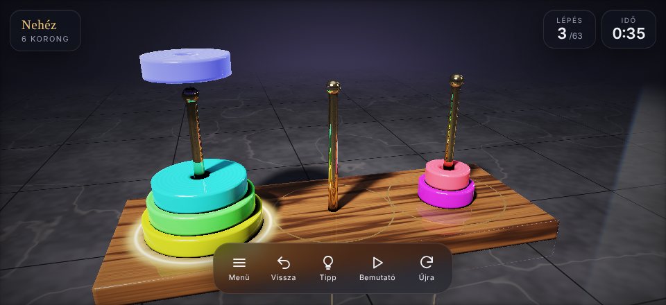

# Hanoi Tornyai RT

Hanoi tornyai játék Androidra, valós idejű sugárkövetéssel (WebGL fragment shader raytracer, WebView-ban).

## Funkciók
- Analitikus sugárkövetés: korongok, rudak, talapzat; tükröződés, lágy árnyék, ambient occlusion
- Progresszív élsimítás állóképen, adaptív felbontás mozgás közben
- 6 nehézségi szint (3–8 korong), csillagos értékelés, rekordok
- Visszavonás, tipp (optimális következő lépés bármely állásból), automatikus bemutató
- Hang, rezgés, kameraforgatás húzással

## Telepítés
- **Android:** `HanoiTornyaiRT.apk` (Releases), Android 7.0+.
- **Windows 10/11:** `HanoiTornyaiRT-win-x64.zip` (Releases) – kicsomagolás után `HanoiTornyaiRT.exe`. Billentyűk: 1/2/3, Z, H, R, Esc, F11.

## Windows build
`build-win.sh`: Electron win32-x64 + `desktop/` (main/preload) + `app/assets/index.html`; az exe ikonja és verzióadatai `resedit`-tel kerülnek be (wine nélkül).

## Android build (Gradle nélkül)
`build.sh`: javac → dx → aapt2 link → 4 bájtos igazítás + APK Signature Scheme v2 (`tools/apkfinish.py`).
Szükséges: `android.jar` (API 33), `aapt2`, `dx` – az elérési utakat a `build.sh` elején kell beállítani.
Az aláíró kulcs a `keys/` mappába kerül (nincs verziókezelve).

## Szerző
Sisak László (helmetsoft.com)
